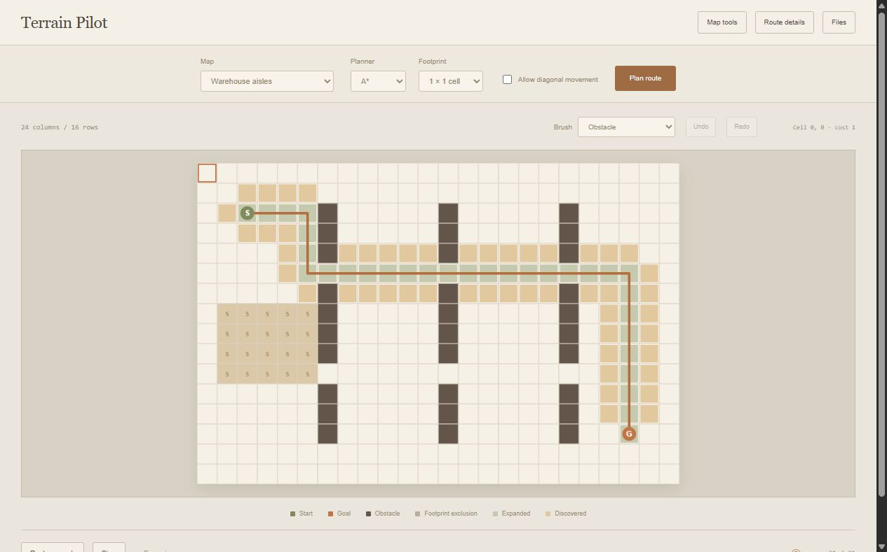

# Terrain Pilot

A browser-based robotics planning lab with weighted terrain, square-footprint obstacle clearance, deterministic A* and Dijkstra searches, and replayable expansion traces.



## Run

```sh
python run.py
```

Open http://127.0.0.1:8000/. Python 3.10+ serves four static assets on loopback; all planning happens in the browser. Use `--port 8831` for another port. No runtime packages, external assets, or robot hardware are required.

## Interface

The map is the main workspace, with terrain brushes, undo/redo, and search playback beside it. Planning controls sit above the map; coordinate editing, route comparisons, and file tools open separately. The canvas scales for narrow screens and high-density displays.

## Explore

- Compare A* and Dijkstra on warehouse aisles, expensive terrain, a narrow passage, or an open field.
- Paint obstacles and terrain weights, or move the start and goal. Use a pointer, keyboard arrows plus Enter, or explicit row/column controls.
- Undo and redo up to 100 map edits. One continuous pointer stroke forms one undo entry.
- Select a 1 × 1, 3 × 3, or 5 × 5 axis-aligned square footprint. Obstacle dilation and map boundaries exclude centers where that footprint cannot fit.
- Enable diagonal movement without cutting blocked corners.
- Replay, pause, step, and scrub the expansion history. Reduced-motion preferences skip automatic replay; manual stepping remains available.
- Save/open map JSON, export a route CSV, and download both planners' results and traces. Editing invalidates previous results and exports. Route exports are enabled at the completed replay position.

The default warehouse example gives both algorithms a route cost of 30. A* expands 31 cells; Dijkstra expands 342. These are deterministic counts for this example, not a claim about all maps. Runtime figures are single browser measurements, not rigorous benchmarks.

## Planning model

Cells are integers: `0` is an obstacle and `1–9` are traversable terrain weights. A move costs the **destination** cell weight, multiplied by √2 for diagonals. The starting cell has no entry cost. This makes the weighted graph potentially asymmetric even though neighboring geometry is symmetric.

A* uses Manhattan distance for four-neighbor movement and octile distance for eight-neighbor movement. Terrain weights are at least one, so these heuristics are admissible and consistent. Dijkstra uses zero heuristic. Both use a binary heap, stable tie-breaking, stale-entry rejection, and a closed set. Tests compare their costs against Bellman–Ford.

Clearance is discrete square dilation, including exclusion near map edges. It is not a Euclidean distance field or Nav2's exponential inflation layer. Terrain cost is sampled at the robot's center, not averaged over the footprint. This model has no robot rotation, acceleration, steering constraints, dynamic obstacles, continuous collision checking, localization, or real-world safety guarantees.

## Files and architecture

- `core.js`: strict map validation, footprint exclusion, neighbor generation, heap search, trace recording, and path ledger validation.
- `app.js`: canvas drawing, accessible coordinate editing, undo/redo, replay, comparisons, and downloads.
- `run.py`: explicit asset allowlist, loopback binding, Host checks, and security headers.

Map JSON contains exactly `width`, `height`, `cells`, `start`, `goal`, `diagonal`, and `clearance`. Dimensions are 3–40 cells; cells are row-major, and start/goal are zero-based cell indices. Clearance is 0, 1, or 2. A blocked endpoint is a reported planning outcome rather than a malformed file. Import files are limited to 32 KB.

## Verification

```sh
node --test
npm run check
python -m unittest discover -s tests -v
```

Node.js 22+ is needed for tests; no npm install is required. Ten JavaScript tests cover Manhattan/octile distances, terrain detours, corner restrictions, footprint dilation, narrow passages, 100 seeded weighted-map comparisons with Bellman–Ford, heuristic consistency, deterministic traces, malformed inputs, legal route ledgers, and input immutability. One Python test verifies static assets, blocked filesystem routes, Host rejection, and HEAD responses. CI runs on Linux and Windows.

Browser checks cover clearance changes, obstacle editing, undo, replay/pause/step/scrubbing, and exported route coordinates and cost.

## References

- [Red Blob Games: introduction to A*](https://www.redblobgames.com/pathfinding/a-star/introduction.html)
- [Nav2: costmap concepts](https://docs.nav2.org/rolling/configuration_and_development/configuration_guide/core_servers/costmap_2d/)

The implementation is standalone and does not use ROS or Nav2.
